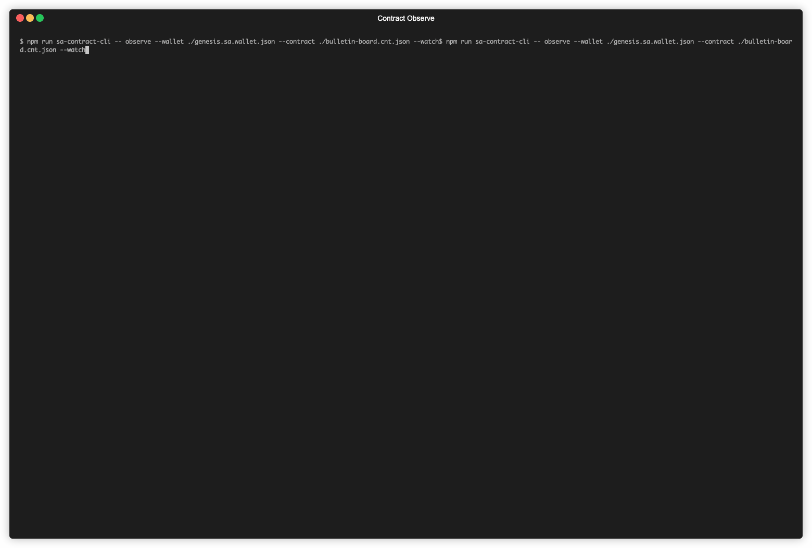

# contract-cli
Utilities to work with smart contracts. Primary usage for this tool is to deploy, observe and interact with compiled Compact contracts.

## Manipulating contract private state
All contracts are, by default, using "private state forwarding witnesses". Contracts requiring some private data, like `privateKey` used in bulletin board contract, can be supplied as 
command line array arguments. The syntax is `privateState.<property name> = <js value>`. For easier work, there is a `util` module available to convert values easily e.g.:
```bash
--private-state="privateState.uintArray = util.fromHex('DEADBEEF')" "privateState.boolean = true" "privateState.number = 42" "privateState.string = 'Hello world'"
```
Will generate and use private state:

```
{
  uintArray: <Buffer de ad be ef>,
  boolean: true,
  number: 42,
  string: 'Hello world'
}
```

The private state manipulation is enabled only for `observe` and `interact` commands.

## Deploy
Deploy compiled contract. Currently, only contract that are compiled and listed in [@cap/contract lib](../../libs/contract/README.md) are supported. Any compiled contracts are not supported.
Tool support storing deployed contract data in JSON file for easier interaction using the command line options:
```
-o,--output
-x,--override
```
Example:
```
contract-cli deploy --wallet ./my.wallet.json --contract @cap/bulletin-board-contract/compiled --output bulletin-board
```
Output:
```
Deploying contract {
  contractDir: '/cap/contracts/bulletin-board/dist/compiled',
  networkId: 'Undeployed'
}
Contract deployed {
  networkId: 'Undeployed',
  contractModule: '@cap/bulletin-board-contract/compiled',
  contractAddress: '02005449464fddb937330fd776acaf037e8e23646b9088621bdbcb67af5ca0fde437',
  privateState: {
    localSecretKey: {
      type: 'Uint8Array',
      hex: 'fc60f3383ac48e762daa295fc1689c63e534a09b11604208052b9bade0c33256'
    }
  }
}
Contract stored { path: 'bulletin-board.cnt.json' }
```

## Interact
Interact with a contract. Currently only supported interaction is calling an exported circuit. Either `contract` which is path to a contract serialization is passed or `module` and `address` is required.

Some of the circuit requires arguments, like bulletin board contract circuit `post`, which requires single argument of type `Opaque<"string">` which is JavaScript type `string`. It also requires `localSecretKey`, which is by default random.
The arguments are passed with option `--arguments`. The syntax is array of values, the `util` library is also present, e.g.:
```
--arguments "[util.fromHex('DEADBEEF'), true, 42, 'Hello World']"
```

Will result in call:
```
Calling circuit {
  circuitName: ...,
  args: [ <Buffer de ad be ef>, true, 42, 'Hello World' ],
  privateState: { ... }
}
```

Example:
```bash
$ contract-cli interact --wallet ./genesis.sa.wallet.json --contract ./bulletin-board.cnt.json --privateState "privateState.localSecretKey = util.fromHex('DEADBEEFDEADBEEFDEADBEEFDEADBEEFDEADBEEFDEADBEEFDEADBEEFDEADBEEF')" --circuit post --arguments "['Hello World']"
```
Output:
```
Calling circuit {
  circuitName: 'post',
  args: [ 'Hello World' ],
  privateState: {
    localSecretKey: {
      type: 'Uint8Array',
      hex: 'deadbeefdeadbeefdeadbeefdeadbeefdeadbeefdeadbeefdeadbeefdeadbeef'
    }
  }
}
Transaction finished {
  result: [],
  status: 'SucceedEntirely',
  txId: '00000000415d486f5f2d532c2d8524275262305b83be55f5fc77f07dc52bde7cfa67758f',
  txHash: '84f9cafa13c8fc7e9bba29dbe41a6e3204f2b61b0060f6d0996c50191d48047d',
  blockHeight: 5206,
  blockHash: '113b789721645dca12d9fb6100d1bd77ee0867a5402b500c995aeac628259efa'
}
```

## Observe
Observe ledger state of deployed contract. Loads the latest state and displays it in human-readable format.

Example:
```bash
contract-cli observe --wallet ./my.wallet.json --contract ./bulletin-board.cnt.json
```
Output:
```
{
  state: 0,
  message: { is_some: false, value: '' },
  sequence: 1n,
  owner: {
    type: 'Uint8Array',
    hex: '0000000000000000000000000000000000000000000000000000000000000000'
  }
}
```

Observe also supports the `--watch` mode, where it is possible to watch for live updates, and preview previous states of the contract.

Example:
```bash
contract-cli observe --wallet ./my.wallet.json --contract ./bulletin-board.cnt.json --watch
```


