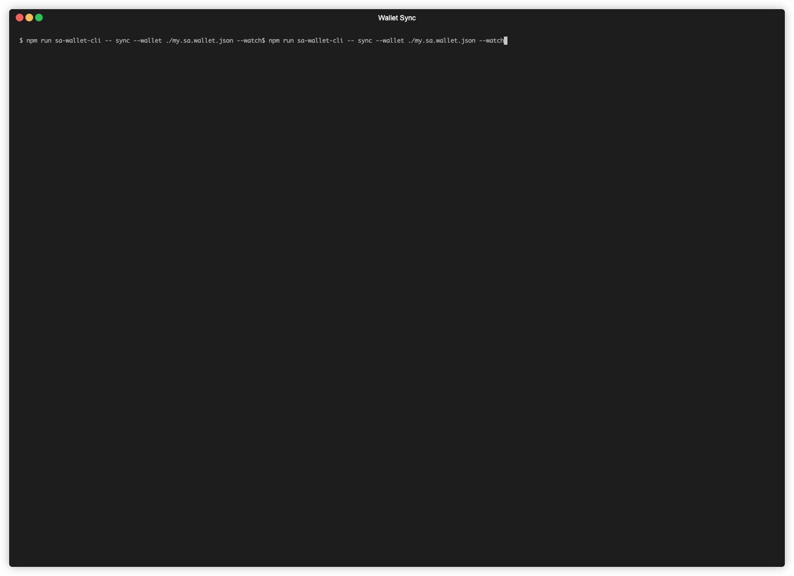

# wallet-cli
Terminal tool for working with Midnight Wallets. Supports generating and importing wallets from the [Lace Midnight Preview](https://chromewebstore.google.com/detail/lace-midnight-preview/hgeekaiplokcnmakghbdfbgnlfheichg).
Use help for detailed argument and command explanation.
```bash
$ wallet-cli <command> --help
```
__WARNING: THE GENERATER WALLETS ARE DUMPED UNENCRYPTED AND UNSECURED DIRECTLY ONTO A DISK.__

## Required network specification arguments
```
--indexer-url
--indexer-ws-url
--prover-url
--node-url
--network-id
```
These are required arguments that specify, which exact network the tooling is working against.
These points to the running node, indexer and prover. All of them must target same type of network.
These values default to midnight testnet. See [standalone environment file](../../standalone.env), how to set them in dotenv file.

## Supported Commands
### Common Arguments
The wallet support advanced wallet derivation arguments:
```
--select-account
--address-role
--derivation-index
```
See the [midnight-ntwrk/wallet-sdk-hd](https://www.npmjs.com/package/@midnight-ntwrk/wallet-sdk-hd) module for detailed explanation.

### Generate
Generate a wallet. The generated wallet can be stored in common format on disk to be used in following utilities.
File saving arguments:
```
-o,--output
-x,--override
```
If output argument is provided the generated wallet is not printed to the terminal, but saved as `<output>.wallet.json`.

#### Random wallet
```bash
$  wallet-cli generate
```
Example output:
```
{
  mnemonics: [
    'assault', 'congress', 'kingdom',
    'skill',   'cat',      'lesson',
    'reason',  'ski',      'abstract',
    'section', 'icon',     'under',
    'summer',  'quiz',     'coffee',
    'file',    'purity',   'remind',
    'autumn',  'advice',   'kick',
    'cabbage', 'shield',   'unviel'
  ],
  seed: '1e4faba3f846ed8d7614e4c37210494c648c273ce17e62d90072f2e0b6fe2904',
  state: {
    address: 'mn_shield-addr_test1k3wtlkkhwamaxz7wc6hqe43avjmv0h7j8wfy8tnhyjcjvn52s2jqxqyu3juqfqzj2zarchmf6remwm0sxexmsjsvvfvmayfk8cltwmt5vye2x56d',
    coinPublicKey: 'mn_shield-cpk_test1k3wtlkkhwamaxz7wc6hqe43avjmv0h7j8wfy8tnhyjcjvn52s2jqu9sxrv',
    encryptionPublicKey: 'mn_shield-epk_test1qvqfer9cqjq9y596830kn58nkaklqdjdhp9qccjeh6gnv037kakhgcgqzspk6'
  }
}
```
This generated wallet can be imported into the lace, using the random mnemonics.

#### Import/Regenerate from mnemonics
```bash
$ wallet-cli generate --mnemonics assault congress kingdom skill cat lesson reason ski abstract section icon under summer quiz coffee file purity remind autumn advice kick cabbage shield unviel
```
This way allow to regenerate or import lace wallet.

#### Generate from seed
```bash
$ wallet-cli generate --seed '000000000000000000000000000000000000000000000000000000000000001'
```
Similar to the generating from mnemonics, but instead only the seed is passed. This is good for generating specific wallets
with well-known seeds, like the genesis wallet for the Undeployed network.

### Sync
Synchronize the wallet, so it matches the latest network state, updating balances, transaction history etc. Works only with serialized wallet generated with `generate` command.
```bash
$ wallet-cli sync --wallet ./my.wallet.json
```
Output:
```
{
  address: 'mn_shield-addr_test1k3wtlkkhwamaxz7wc6hqe43avjmv0h7j8wfy8tnhyjcjvn52s2jqxqyu3juqfqzj2zarchmf6remwm0sxexmsjsvvfvmayfk8cltwmt5vye2x56d',
  addressLegacy: 'b45cbfdad77777d30bcec6ae0cd63d64b6c7dfd23b9243ae7724b1264e8a82a4|03009c8cb804805250ba3c5f69d0f3b76df0364db84a0c6259be91363e3eb76d7461',
  availableCoins: [],
  balances: {},
  coinPublicKey: 'mn_shield-cpk_test1k3wtlkkhwamaxz7wc6hqe43avjmv0h7j8wfy8tnhyjcjvn52s2jqu9sxrv',
  coinPublicKeyLegacy: 'b45cbfdad77777d30bcec6ae0cd63d64b6c7dfd23b9243ae7724b1264e8a82a4',
  coins: [],
  encryptionPublicKey: 'mn_shield-epk_test1qvqfer9cqjq9y596830kn58nkaklqdjdhp9qccjeh6gnv037kakhgcgqzspk6',
  encryptionPublicKeyLegacy: '03009c8cb804805250ba3c5f69d0f3b76df0364db84a0c6259be91363e3eb76d7461',
  nullifiers: [],
  pendingCoins: [],
  transactionHistory: [],
  syncProgress: { lag: { applyGap: 0n, sourceGap: 0n }, synced: true }
}
```
Sync support advanced commands, like printing only subset of keys using the `--path` command:
```bash
$ wallet-cli sync --wallet ./my.wallet.json --path address coinPublicKey encryptionPublicKey
```
Output:

```
{
  address: 'mn_shield-addr_test1k3wtlkkhwamaxz7wc6hqe43avjmv0h7j8wfy8tnhyjcjvn52s2jqxqyu3juqfqzj2zarchmf6remwm0sxexmsjsvvfvmayfk8cltwmt5vye2x56d',
  coinPublicKey: 'mn_shield-cpk_test1k3wtlkkhwamaxz7wc6hqe43avjmv0h7j8wfy8tnhyjcjvn52s2jqu9sxrv',
  encryptionPublicKey: 'mn_shield-epk_test1qvqfer9cqjq9y596830kn58nkaklqdjdhp9qccjeh6gnv037kakhgcgqzspk6'
}
```

The sync command supports the __watch mode__ witch allow to watch for real time updated and scroll in change history of wallet. Watch mode controls:
- Mouse wheel to scroll the content
- Arrows key to scroll between historical values
- Ctrl+C to quit



### Transfer
Transfer coins from one wallet to another. The sender wallet needs to be a serialized wallet, where recipient is just an address. This is good, for setting up undeployed network wallets, that can be 
funded only from the Genesis wallet. As midnight transactions needs to be proven, which takes a while, the whole ordeal can take up to a few minutes. On testnet, this is much worse, where proving the transaction takes
several minutes and the indexer is behind the so the syncing can take *up to hours*. 

```bash
$ wallet-cli transfer --wallet ./genesis.sa.wallet.json --receiver mn_shield-addr_undeployed1229xz8d0atn5lay5kw9gsv5s2hrtlwmr3n345u924u8r3zllvprsxqxu3dlzq0g5v4qcs7dv8ehv79a47hj4utkwmm5m46cdur2srtyfzvh7xmwu --amount 1000000
```
Output:
```
Proving transfer transaction. This might take a minute ...
Transaction proven. Submitting.
Transaction submitted. It may take a while this changes to propagate {
  transactionIdentifier: '0000000007c21b318665dfb8906d5231a6d369aab14374b8605f2eac85243200228e9889'
}
```
